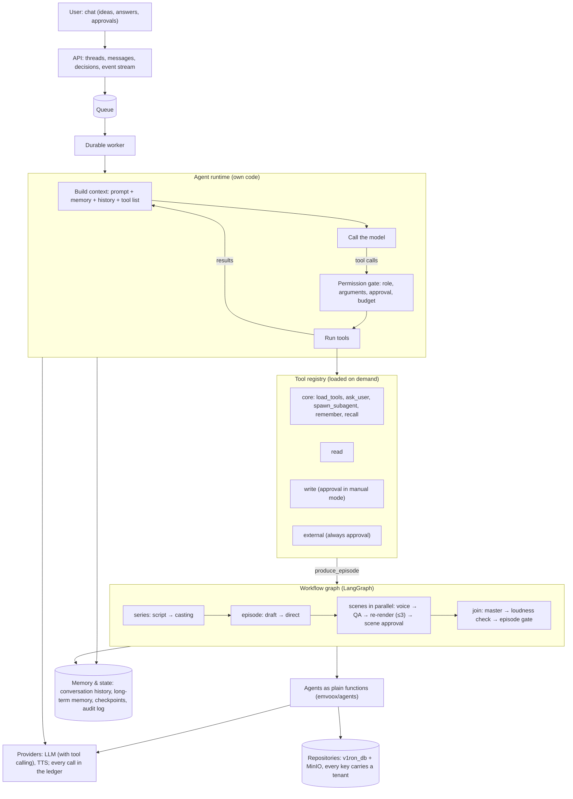

# Emvoox Engine: target architecture (agentic platform)

| | |
|---|---|
| Status | Target design. **Built (Phases 0-4): the workflow graph, durable runs with PostgreSQL / Redis and tenant-scoped storage, the tool registry and agent runtime, the chat.** Not built: long-term memory and compaction (§4.4), users, roles, per-tenant keys, budgets and metering (§4.6), MinIO. What runs is described in `docs/ARCHITECTURE.md` |
| Date | 2026-10-12, updated 2026-10-13 |
| Plan | `docs/MIGRATION_PLAN.md` (phases, exit criteria) |
| Gate | The LangGraph choice (F1) was confirmed by the Phase 0 trial on 2026-10-13 |

## 1. Why the architecture changes

Prototype V1 is a fixed pipeline: code decides the order of steps and the LLM fills in typed answers. Three goals do
not fit that shape:

1. **The workflow is the product.** Emvoox sells its production pipeline to other studios (B2B SaaS). Customers need
   variations of the workflow, and developers need to add skills and tools to an agent without touching the core.
2. **Production branches.** Real production is not linear: scenes run in parallel, each with its own
   regenerate → QA → approve loop, and a reviewer may hold one scene while the others continue.
3. **AI-first interface.** The user describes an idea in a chat; agents plan, pick tools and do the work, and stop only
   where a human decision is needed.

## 2. Shape

Two kinds of execution, each used where it fits:

| | Agent loop | Workflow graph |
|---|---|---|
| Who decides the next step | The model, by calling tools | The graph |
| Used for | Work whose path is not known in advance: market research, developing a story with the user, casting choices, the Producer conversation | Work that spends vendor money and carries quality guarantees: producing an episode |
| Guarantee | Bounded by permissions, budget and max steps | QA, mastering and the human gate cannot be skipped or reordered |
| Runs on | Emvoox agent runtime (own code) | LangGraph (F1) |

An agent starts production by calling a tool; that tool runs the workflow graph. The model never drives the graph's
internal steps.

## 3. What is kept, what changes, what is new

| Area | Today | Target |
|---|---|---|
| Agents (`emvoox/agents`) | Classes with skill methods | **Kept.** They become the bodies of graph nodes and of tools |
| Contracts (`emvoox/contracts`) | Validated at every step handoff | **Kept and extended**: also the argument and result schemas of every tool |
| LLM adapters | `LlmClient.structured()` only | **Extended** with tool calling; still our adapters (E4 holds), no LangChain model classes |
| TTS adapters, delivery, audio | As built | **Kept** |
| Ledger and pricing | Every LLM/TTS call and step | **Kept and extended**: tool calls, budgets enforced, per-tenant metering |
| Orchestration (`engine/orchestrator.py`) | Hand-written asyncio state machine, one thread per run | **Replaced** by the workflow graph (F1) and a durable worker |
| QA loop | Per line, inside one episode, sequential | **Reshaped**: per scene, scenes in parallel, episode master as the join |
| Human gate | Ends the run; approval is a separate call | **Reshaped**: a scene can pause the run for approval; the episode gate still parks the episode without blocking the run (O7) |
| Storage | Local JSON/SQLite + disk, no tenant | **Moved** to `v1ron_db` + MinIO behind the same repositories; tenant in every key |
| Web app | Pages and a wizard | **Reshaped**: chat first; existing pages become views the chat links to |
| Tool registry, agent runtime, memory, compaction, tenants, roles | None | **New** |

## 4. Components

### 4.1 Workflow graph
- Three nested graphs: **series** (script, casting), **episode** (draft, direct, then scenes), **scene** (voice → QA →
  re-render up to `max_retries` → scene approval).
- Scenes fan out in parallel. Concurrency is capped **per provider** (vendor rate limits), not globally.
- The episode **join** waits for every scene, then masters the episode, checks loudness (-16 LUFS / -1.5 dBTP) and
  opens the episode gate (D11).
- Node bodies are the existing agent methods. Every node output is validated against its contract, as today.
- State is checkpointed after each step. A paused step re-runs from its start on resume, so **every node must be safe
  to repeat**; stems already are (content-hash cache).

### 4.2 Agent runtime
- One loop for every agent: build context → call the model → permission gate → run tools → repeat until the model
  answers without a tool call. Each turn checks the budget and the step limit.
- An agent is **configuration**: prompt, tool areas, memory scope, model, budget.
- A **Producer** agent owns the user's conversation and hands work to the specialist agents as sub-agents.

### 4.3 Tool registry
- A tool = a function + Pydantic argument model + Pydantic result model + `area` + `kind`.
- Kinds: `core` (always loaded), `read` (runs at once), `write` (needs approval in manual mode), `external` (spends
  money or publishes; always needs approval).
- Only `core` is in the context by default; other areas are loaded on demand so the tool list does not fill the window.
- Existing skills are wrapped, not rewritten. Adding a tool or an agent does not touch the runtime.

### 4.4 Memory and compaction
- **Conversation history** per thread: messages, tool calls and results, append-only.
- **Long-term memory** per tenant and agent, written with `remember`, read with `recall`, visible and editable by a
  human. Never shared across tenants.
- **Domain data** (series bible, Voice IP registry, briefs) stays the source of truth and is never copied into memory.
- **Compaction**, applied in order as the context fills: clear old tool results → summarise older turns with one model
  call → drop the oldest turns. Large tool results (scraped pages) are stored as blobs; the conversation keeps an
  excerpt and a reference.

### 4.5 Durable worker and human pauses
- A run is queued and executed by a worker process. Checkpoints save state; the worker and queue are what restart it.
- `ask_user`, a tool that needs approval, or a graph gate pauses the run and frees the worker. The answer re-queues it.
- Planned pause points: pick one of the three trending genres, approve the cast, approve spend above budget, approve a
  scene, approve an episode.

### 4.6 B2B SaaS
- Tenant id on every storage key and row; every query filtered by tenant. Voice IPs, provider keys and memory are
  per tenant.
- Runs execute as the signed-in user; a role decides which tools are visible and callable.
- Hard budgets per run and per tenant; concurrency limits per tenant replace "one series at a time" (D12).
- Metering per tenant: LLM tokens, TTS characters, exported minutes, storage.

## 5. Decisions

Adopted decisions define the direction. Open items need the Lead Architect.

| # | Decision | Status |
|---|---|---|
| F1 | The workflow graph runs on **LangGraph**; agents, contracts, providers, ledger and storage stay our own code. Supersedes E1 | **Adopted** 2026-10-13: the Phase 0 trial passed all four checks (`docs/MIGRATION_PLAN.md`) |
| F2 | Agent loop where the path is unknown; deterministic graph for episode production. The model cannot skip QA, mastering or the gate | Adopted |
| F3 | Model-callable tool registry with Pydantic schemas, `area` and `kind`, loaded on demand; existing skills are wrapped | Adopted |
| F4 | LLM adapters gain tool calling; E4 holds (no LangChain model classes, no LiteLLM) | Adopted |
| F5 | The scene is the unit of QA and approval; scenes run in parallel under per-provider limits; mastering is the episode join | Adopted |
| F6 | Runs are durable: worker process, queue, checkpoints, pause and resume. PostgreSQL and Redis locally (O2) | Adopted |
| F7 | Three stores: conversation history, long-term memory per tenant and agent, domain data as source of truth | Adopted. Agents save automatically; a person reads, edits and deletes (O4) |
| F8 | Compaction in three tiers; large tool results as blobs | Adopted |
| F9 | AI-first chat; one Producer agent owns the conversation and delegates. No direct chat with each agent (O3) | Adopted |
| F10 | Multi-tenant from the storage move onward: tenant in every key, roles, per-tenant keys, budgets and limits | Adopted |
| F11 | Safety rules: D11 stays; `external` tools always need approval; scraped text is data, never instructions; a blocked page is never worked around; budgets are hard caps | Adopted |
| F12 | The offline test suite stays: the mock LLM gains scripted tool calls; sockets remain blocked | Adopted |

Effect on earlier decisions: **E1** is superseded by F1; the native engine remains the default until Phase 1 replaces it. **D12** (one series at a time, episodes
sequential) replaced by F5 and F10. **D7** proceeds to its planned V1RON storage, now with tenants. **D11**, **E3**,
**E4**, **E6** (bounded retries) and **E7** hold.

### Open items

| # | Question | Answer or default |
|---|---|---|
| O1 | Does the Phase 0 trial pass? | **Closed 2026-10-13: passed**, on the mock providers |
| O2 | Run state and queue | **Decided 2026-10-13: PostgreSQL and Redis locally**; the same adapters reach `v1ron_db` and MinIO |
| O3 | Chat shape | **Decided 2026-10-13: one Producer agent that delegates** |
| O4 | Long-term memory writes | **Decided 2026-10-13: agents save automatically; a person reads, edits and deletes** |
| O5 | Google as a research source: Gemini with Google Search grounding, or a search API? | **Still open.** The WaveSpeed gateway has no real search (checked 2026-10-13); either option needs a key that is not in `.env` |
| O6 | Which model runs loop agents? | **Measured 2026-10-13:** `gemini-3.1-flash-lite` completed the research loop 2 of 2 with no invalid call, as did `gemini-3.6-flash` at ten times the cost. The default stays; an agent can name its own model |
| O7 | Should an episode waiting for approval block the run? | **Decided 2026-10-13: no.** A PASS episode is parked and the run continues; only a FLAGGED episode halts |
